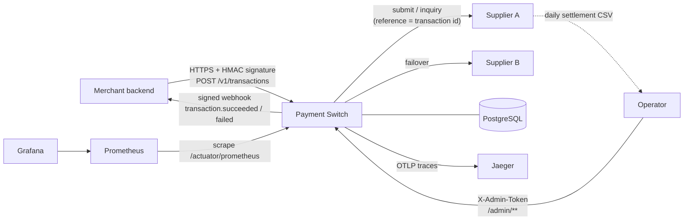
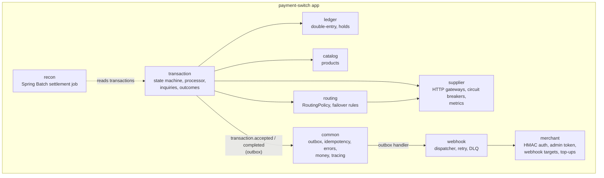
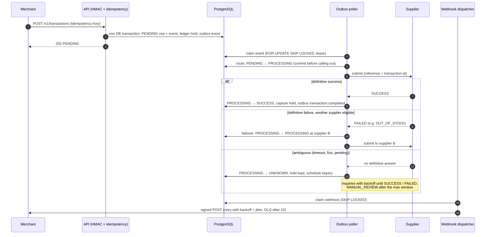
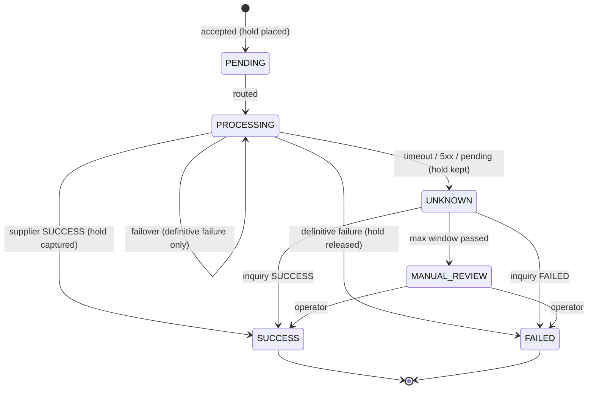
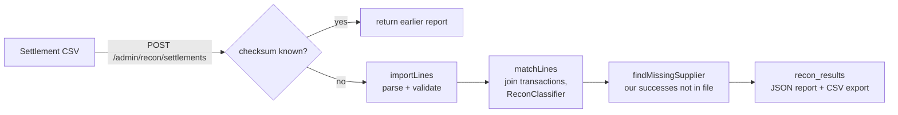

# Architecture

A **modular monolith** (ADR-001): one Spring Boot application, one PostgreSQL database, with modules
that talk to each other only through public services and outbox events. A separate small app,
`mock-supplier`, plays the role of the external suppliers.

## Context

## Modules

Module rules: no module reads another module's repository. Money moves only through
`LedgerService`. Status changes only through `TransactionStateMachine`. Work that must happen after
a commit goes through the outbox.

## Transaction flow

## State machine

Every transition is a compare-and-set on the current status plus an append-only
`transaction_events` row, in the same database transaction as its ledger effect.

## Ledger postings

| Operation | Debit | Credit |
|---|---|---|
| Top-up (deposit received) | CASH | MERCHANT_BALANCE |
| Hold (transaction accepted) | MERCHANT_BALANCE | MERCHANT_HOLD |
| Release (FAILED) | MERCHANT_HOLD | MERCHANT_BALANCE |
| Capture (SUCCESS) | MERCHANT_HOLD (price) | SUPPLIER_PAYABLE (cost) + REVENUE (margin) |

Balances are always `SUM(entries)`; there is no balance column (ADR-003). Journals must balance per
currency, and journals and entries cannot be changed once posted. Both rules are enforced by
database triggers.

## Reconciliation

## Reliability mechanisms

| Concern | Mechanism | Where |
|---|---|---|
| Duplicate API requests | Idempotency key claimed in the same DB transaction as the action | ADR-002 |
| Concurrent spending | Per-merchant row lock on the balance account, READ COMMITTED | ADR-004 |
| Crash after commit | Transactional outbox, leased claims, resubmit with the same reference | ADR-006 |
| Ambiguous supplier result | `UNKNOWN`, hold kept, inquiries, `MANUAL_REVIEW` | ADR-005 |
| Double top-up via failover | Failover only after definitive failures | ADR-008 |
| Supplier outage | Circuit breaker per supplier, routing skips open circuits | ADR-008 |
| Lost notifications | At-least-once webhooks, stable event id, DLQ + re-drive | ADR-007 |
| Late or contradicting answers | `transaction_discrepancies`, never auto-applied | ADR-005 addendum |
| Supplier billing errors | Settlement reconciliation | Phase 7 |
| Following one transaction | Trace context stored with outbox and webhook events | ADR-009 |

## Observability

- **Metrics** (`/actuator/prometheus`, dashboard *Payment Switch* in Grafana):
  - `paymentswitch_transactions_total{status}` and `paymentswitch_transactions_open{status}`
  - `paymentswitch_supplier_calls_seconds{supplier,operation,outcome}` (histogram)
  - `resilience4j_circuitbreaker_state`
  - `paymentswitch_outbox_pending` and `paymentswitch_outbox_lag_seconds`
  - `paymentswitch_webhooks_deliveries_total{outcome}` and `paymentswitch_webhooks_dead`
  - `paymentswitch_inquiries_total`, `paymentswitch_failovers_total`, `paymentswitch_discrepancies_total`
  - Spring's `http_server_requests_seconds`
- **Traces**: OpenTelemetry via Micrometer Tracing, exported over OTLP to Jaeger. A single trace
  follows a transaction across the outbox to the supplier and the webhook (ADR-009).
- **Logs**: structured JSON (ECS) in Docker, with `traceId`, `spanId`, `requestId`, `merchantId`
  and `transactionId` from the MDC. Secrets, API keys and signatures are never logged.
